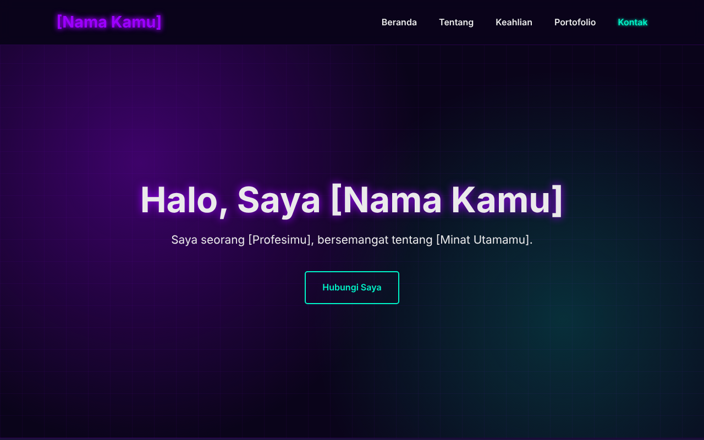

# Personal Profile Website

[🇮🇩 Bahasa Indonesia](#-bahasa-indonesia) · [🇬🇧 English](#-english)



Template website profil pribadi satu halaman bertema *neon purple*, dibangun murni dengan **HTML & CSS** tanpa JavaScript, tanpa framework, dan tanpa dependensi eksternal.

A single-page personal profile website template with a *neon purple* theme, built with pure **HTML & CSS**: no JavaScript, no framework, no external dependencies.

---

## 🇮🇩 Bahasa Indonesia

### Fitur
- Satu halaman dengan bagian Beranda, Tentang, Keahlian, Portofolio, dan Kontak
- Responsif dari layar 320px hingga desktop
- **Tanpa JavaScript** dan **tanpa request ke pihak ketiga** (font sistem, latar hero dibuat dengan CSS)
- Content-Security-Policy yang ketat
- Aksesibel: tautan "lewati ke konten", indikator fokus keyboard, teks `alt`, dan mendukung `prefers-reduced-motion`
- Gambar placeholder SVG yang ringan (total < 5 KB)

### Struktur
```
.
├── index.html
├── assets/
│   ├── css/style.css
│   └── images/          # profile.svg, project-1..3.svg, favicon.svg
├── docs/preview.png
├── LICENSE
└── README.md
```

### Cara Menggunakan
1. **Clone / unduh** repository ini:
   ```bash
   git clone https://github.com/<username>/<nama-repo>.git
   cd <nama-repo>
   ```
2. **Buka** `index.html` langsung di browser. Tidak perlu instalasi atau build apa pun.
3. **Personalisasi.** Ganti semua teks dalam kurung siku di `index.html`:

   | Placeholder | Ganti dengan |
   |---|---|
   | `[Nama Kamu]` | Nama Anda (judul tab, logo, hero, footer) |
   | `[Profesimu]`, `[Minat Utamamu]` | Profesi & minat Anda |
   | `[Bidang Keahlian 1..3]` | Keahlian Anda |
   | `Nama Proyek 1..3` | Proyek Anda |
   | `[Tahun]` | Tahun hak cipta |
   | `email@contoh.com`, `github.com/username`, `linkedin.com/in/username` | Kontak Anda |

4. **Ganti gambar** di `assets/images/` dengan milik Anda (misalnya `profile.jpg`), lalu sesuaikan atribut `src` di `index.html`.
   - Kompres gambar dulu (misalnya dengan [Squoosh](https://squoosh.app)). Ukuran ±500px untuk foto profil dan ±800px untuk gambar proyek sudah cukup.
   - **Hapus metadata EXIF/GPS** dari foto pribadi sebelum di-upload, karena metadata ini bisa membocorkan lokasi.
   - Pastikan Anda memiliki hak atau lisensi atas setiap gambar yang dipakai.
5. **Ganti warna** lewat variabel CSS di bagian atas `assets/css/style.css` (`--neon-purple`, `--accent-cyan`, dan lainnya).

### Publikasi dengan GitHub Pages
1. Push ke GitHub, lalu buka **Settings → Pages**.
2. Pada *Source*, pilih **Deploy from a branch**, branch `main`, folder `/ (root)`.
3. Situs akan tersedia di `https://<username>.github.io/<nama-repo>/`.

### Catatan Keamanan
- CSP diatur lewat `<meta>` di `index.html`. Halaman hanya boleh memuat CSS dan gambar dari domain sendiri. Script, form, plugin, dan `<base>` diblokir.
- Kalau Anda menambahkan JavaScript nanti, simpan di file `.js` terpisah (jangan inline), lalu tambahkan `script-src 'self'` ke CSP.
- Kalau Anda menambahkan font atau gambar eksternal, tambahkan domainnya ke CSP secara spesifik. Jangan memakai `*`.
- Tautan eksternal memakai `rel="noopener noreferrer"` untuk mencegah *reverse tabnabbing*.
- Situs ini **tidak memakai form kontak** dengan sengaja, supaya tidak ada data pengunjung yang diproses atau bocor. Kalau Anda ingin form, gunakan layanan dengan metode `POST` + HTTPS + proteksi spam, dan perbarui `form-action` di CSP.
- Beberapa header keamanan tidak bisa dipasang lewat `<meta>` (`frame-ancestors`, `X-Content-Type-Options`, `Strict-Transport-Security`). GitHub Pages tidak mendukung header kustom. Kalau Anda membutuhkannya, gunakan hosting seperti Netlify atau Cloudflare Pages dan buat file `_headers`:
  ```
  /*
    Content-Security-Policy: default-src 'none'; style-src 'self'; img-src 'self'; base-uri 'none'; form-action 'none'; object-src 'none'; frame-ancestors 'none'
    X-Content-Type-Options: nosniff
    Referrer-Policy: strict-origin-when-cross-origin
    Permissions-Policy: camera=(), microphone=(), geolocation=()
  ```

---

## 🇬🇧 English

### Features
- Single page with Home, About, Skills, Portfolio and Contact sections
- Responsive from 320px screens up to desktop
- **No JavaScript** and **no third-party requests** (system fonts, CSS-only hero background)
- Strict Content-Security-Policy
- Accessible: skip link, visible keyboard focus, `alt` text, and `prefers-reduced-motion` support
- Lightweight SVG placeholder images (< 5 KB total)

### Usage
1. **Clone / download** this repository:
   ```bash
   git clone https://github.com/<username>/<repo-name>.git
   cd <repo-name>
   ```
2. **Open** `index.html` in your browser. No install or build step needed.
3. **Personalize** it by replacing every bracketed placeholder in `index.html` (`[Nama Kamu]` = your name, `[Profesimu]` = your profession, `[Minat Utamamu]` = your main interest, `[Tahun]` = year), plus the skills, projects and contact links. The site text is in Indonesian, so translate it if you need to.
4. **Replace the images** in `assets/images/` and update the `src` attributes.
   - Compress images first.
   - **Strip EXIF/GPS metadata** from personal photos.
   - Only use images you have the rights to.
5. **Change the colors** via the CSS variables at the top of `assets/css/style.css`.

### Deploy to GitHub Pages
Go to **Settings → Pages**, choose *Deploy from a branch*, select `main` and `/ (root)`. Your site will be live at `https://<username>.github.io/<repo-name>/`.

### Security Notes
- CSP is set through a `<meta>` tag: only same-origin CSS and images are allowed, and scripts, forms, plugins and `<base>` are blocked.
- If you add JavaScript, put it in an external `.js` file and add `script-src 'self'`. Never use inline scripts or `unsafe-inline`.
- External links use `rel="noopener noreferrer"`.
- There is intentionally **no contact form**, so no visitor data is processed.
- Headers such as `frame-ancestors`, `X-Content-Type-Options` and HSTS can't be set via `<meta>`, and GitHub Pages doesn't support custom headers. Use Netlify or Cloudflare Pages with the `_headers` example above if you need them.

---

## License
[MIT](LICENSE) © 2026 Rizky Maulana Hafis
